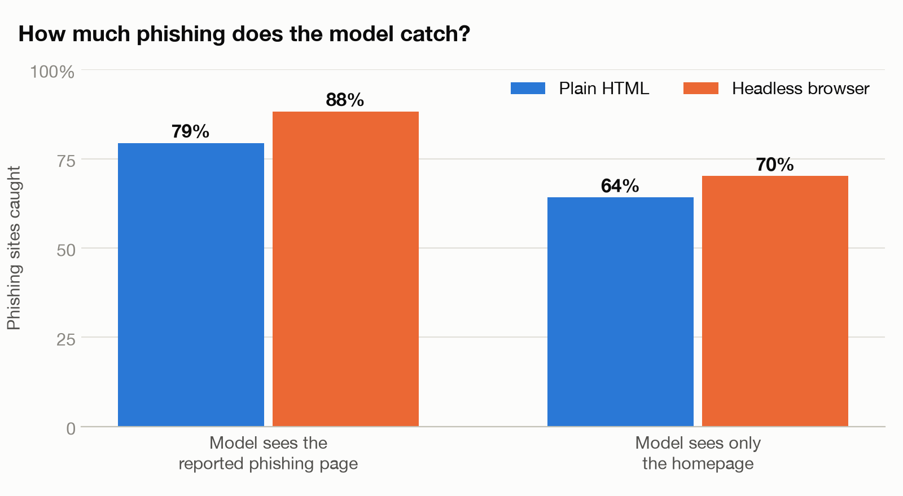
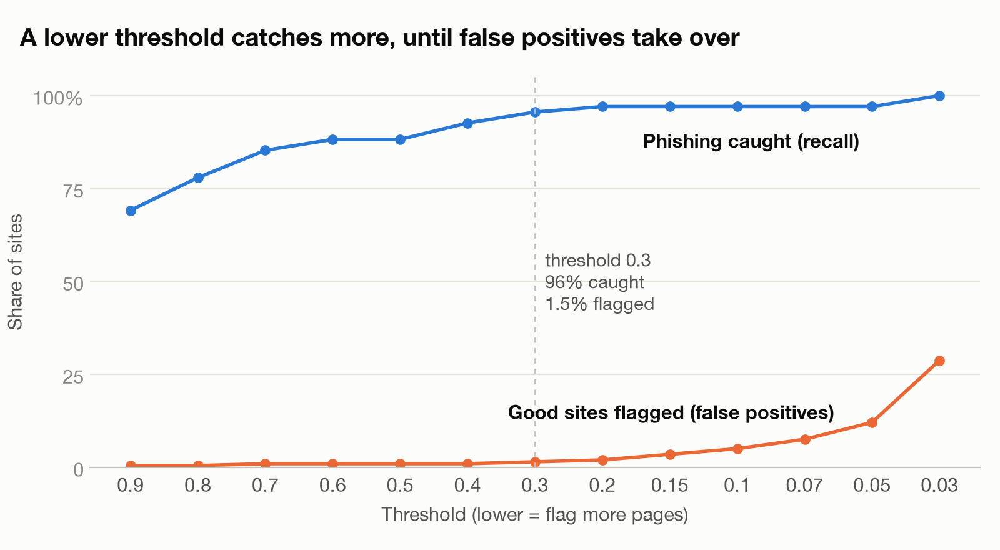
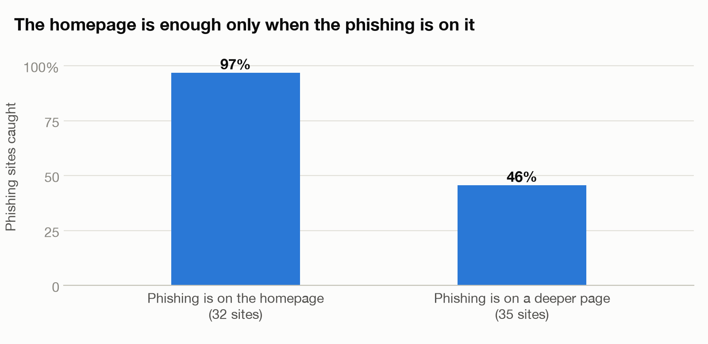
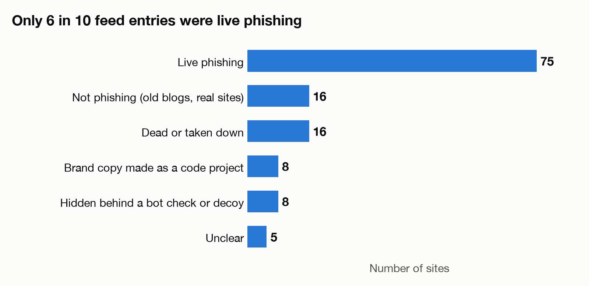

# phishbench

**Can a low-cost decision model find a phishing site from one page?**

A decision model is a small AI model that answers a question with a probability, not
with text. They cost a fraction of a cent for each page. phishbench gives such a model
one web page and asks: *is this phishing?*

First model tested: the OpenAI Decisions API (`gpt-6-luna`), on 9 November 2026.
The full run cost **$0.14**.

## Results

### The model catches most phishing when it sees the page



Each bar is the share of confirmed live phishing sites (67 to 68 sites) that got a
score of 0.5 or more. With a headless browser, which runs the page's JavaScript, the
model caught 88% and flagged 2 of 198 good sites. The browser adds 6 to 9 points over
plain HTML. From the homepage alone, the model caught less; the third chart shows why.

### A lower threshold catches almost all of it



The model gives each page a score from 0 to 1, and the threshold is the score at which
a page is flagged. This chart uses the headless browser view of the reported page, with
68 phishing sites and 198 good sites. At a threshold of 0.3, the model caught 96% of
phishing and flagged 1.5% of good sites. Below 0.1, false positives increase quickly.

### The homepage is enough only when the phishing is on it



A scanner of newly registered domains sees only the homepage. That works when the
phishing page is the homepage. It fails when the phishing is on a deeper page of a
hacked site, a link shortener, or a shared host, where the homepage is harmless.
(Headless browser view, threshold 0.5.)

### Public phishing feeds are noisy



We reviewed all 128 sites that the feed gave us on 9 November 2026. Only 75 were live
phishing. The others were dead, hidden from scanners, or never phishing. All results
above use only the confirmed sites, with duplicates removed (68 sites).

## How it works

1. **Collect.** Fetch live phishing pages from the [OpenPhish](https://openphish.com)
   community feed, and good pages from the [Tranco](https://tranco-list.eu) top 100,000.
2. **Render (optional).** Open each page in headless Chromium in a Docker sandbox.
3. **Reduce.** Change each page into a short text summary: host, title, forms, link
   hosts, and visible text (6,000 characters maximum).
4. **Judge.** Send the summary to a decision model with one fixed question. The model
   gives the probability that the page is phishing.
5. **Score.** Compare with the labels: recall, false positive rate, precision, AUROC.

Each phishing site is tested two ways: the exact page that the feed reported, and the
homepage of the same host.

## Run it

You need [uv](https://docs.astral.sh/uv/), Docker (for the browser step only), and an
OpenAI API key.

```bash
uv sync
cp .env.example .env              # put your OPENAI_API_KEY in .env
uv run phishbench collect         # fetch pages (free)
uv run phishbench run --dry-run   # print the cost estimate
uv run phishbench run             # homepage test, plain HTML
uv run phishbench run --target url
uv run phishbench render          # headless browser, in Docker
uv run phishbench run --view rendered --target url
uv run phishbench score
```

Each `run` stops before its cost goes above `--budget` (default $0.20). A second `run`
continues and does not pay twice for a page.

Phishing sites go offline in hours, so your pages will not be the same as ours, and
your numbers will be different.

## Add a model

1. Make a file in `src/phishbench/models/` with a subclass of `DecisionModel`. Set
   `name` and `usd_per_million_input_tokens`, and write `judge()`.
2. Add the class to `REGISTRY` in `src/phishbench/models/__init__.py`.
3. Run `uv run phishbench run --model <name>`.

`models/openai_decisions.py` is the example. All models get the same page summary and
the same question.

## Limits

- **Small sample.** 68 phishing sites and 200 good sites, from one day. Do not read
  the numbers as exact.
- **The good sites are easy.** Popular sites are not similar to newly registered
  domains. The real false positive rate is probably higher.
- **The label review was done by an AI assistant**, from page summaries and some
  screenshots. A person has not checked each verdict.
- **Text only.** The model does not see screenshots. One sign-in form that was
  visible only in a screenshot got a low score.
- **Page data is not in this repository.** Snapshots contain live phishing HTML, and
  the per-site results name third-party sites. Only total scores are published
  (`results/**/*.summary.json`).

## Contribute

Contributions are welcome. The most useful ones:

- An adapter for a different decision model.
- A harder set of good sites, such as newly registered domains.
- A screenshot view for models that accept images.
- A person's check of the label review method.

Open an issue before a large change. Run `uv run pytest` before a pull request.
Do not commit page snapshots, API keys, or lists of live phishing URLs.

## License

MIT. See [LICENSE](LICENSE).
